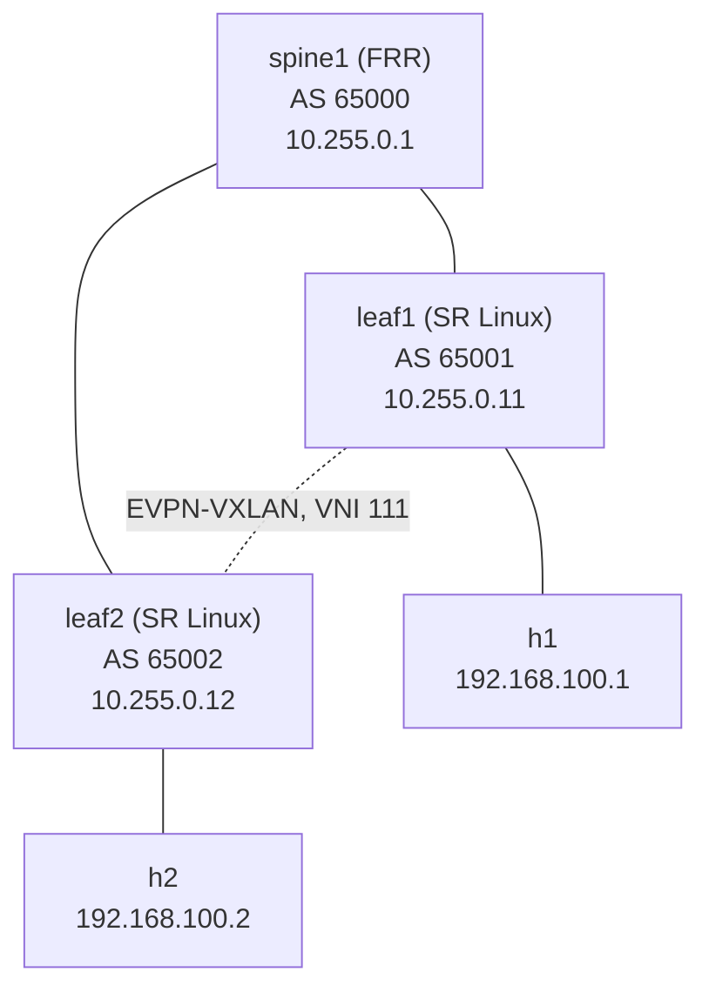

# Network Automation Lab


Multi-vendor EVPN-VXLAN fabric built with Containerlab: an FRRouting spine and two Nokia SR Linux leaves, with a Linux host behind each leaf. The fabric was first configured by hand (to understand every step) and is now fully automated: a YAML data model and Jinja2 templates are pushed to the leaves over JSON-RPC with Ansible, idempotently.

> **Status:** work in progress. See the roadmap below.

## Topology



| Node | Role | Image |
|---|---|---|
| `spine1` | Underlay spine (eBGP) | `frrouting/frr` |
| `leaf1`, `leaf2` | VXLAN leaves (underlay + EVPN overlay) | `ghcr.io/nokia/srlinux` |
| `h1`, `h2` | Hosts in the same L2 segment | `alpine` |

## Addressing plan

| Node | AS | Loopback | Uplink to spine |
|---|---|---|---|
| spine1 | 65000 | 10.255.0.1/32 | 10.0.1.0/31 (to leaf1), 10.0.2.0/31 (to leaf2) |
| leaf1 | 65001 | 10.255.0.11/32 | 10.0.1.1/31 |
| leaf2 | 65002 | 10.255.0.12/32 | 10.0.2.1/31 |

L2 segment: VNI 111 / EVI 111 (`mac-vrf-1`), route target `target:100:111`. Hosts: `h1` 192.168.100.1/24, `h2` 192.168.100.2/24.

## Design

- **Underlay:** eBGP between the spine and each leaf, advertising only the loopbacks (an explicit export policy is required for eBGP).
- **Overlay:** EVPN-VXLAN, with eBGP multihop sessions between the leaf loopbacks. The spine only provides IP transport.

## Automation

The fabric is described as data, not as commands:

```
inventory/
├── hosts.yml              Leaves and how to reach them (JSON-RPC)
├── group_vars/all.yml     Fabric-wide parameters (VNI, EVI, route target, spine AS)
└── host_vars/leaf*.yml    Per-leaf data (AS, loopback, uplink, overlay peer)
templates/srlinux/         Jinja2 templates (interfaces, policies, BGP, EVPN-VXLAN)
playbooks/02-deploy.yml    Renders the templates and applies them with nokia.srlinux.config
```

Adding a leaf means adding a `host_vars` file. The templates were verified against the configuration captured from the manually configured fabric (`tests/golden/`).

- **Idempotent:** a second run reports "already in the desired state".
- **Drift detection:** `--check --diff` shows any difference between the model and the devices.
- **Model-driven:** the configuration travels as YANG-modelled JSON over JSON-RPC, not as scraped CLI text.

## Usage

```bash
python3 -m venv .venv && source .venv/bin/activate
pip install -r requirements.txt
ansible-galaxy collection install -r requirements.yml

sudo containerlab deploy -t fabric.clab.yml      # also assigns the host IPs
ansible-playbook playbooks/02-deploy.yml         # configures the leaves from the data model
docker exec clab-fabric-h1 ping -c 4 192.168.100.2

ansible-playbook playbooks/02-deploy.yml --check --diff   # drift detection
sudo containerlab destroy -t fabric.clab.yml --cleanup
```

Requires Docker and Containerlab (WSL2 on Windows works). The two SR Linux nodes use about 3 GB of RAM. The `manual/` folder keeps the equivalent CLI commands used to build the fabric by hand.

The credentials in the inventory are the default ones of the public lab image; in a real environment they would live in Ansible Vault.

## Evidence

Traffic between `h1` and `h2` captured on the spine: the L2 traffic travels encapsulated in VXLAN (UDP/4789, VNI 111) between the leaf loopbacks.

```
10.255.0.11.53884 > 10.255.0.12.4789: VXLAN, flags [I] (0x08), vni 111
IP 192.168.100.1 > 192.168.100.2: ICMP echo request
10.255.0.12.53628 > 10.255.0.11.4789: VXLAN, flags [I] (0x08), vni 111
IP 192.168.100.2 > 192.168.100.1: ICMP echo reply
```

Each leaf learns the remote host MAC through BGP (`type: evpn`, destination `vtep:<remote loopback> vni:111`), not by flooding.

## Tests and CI

On every push and pull request:

| Step | Purpose |
|---|---|
| `yamllint` | YAML style and syntax |
| `ansible-lint` | Playbook best practices |
| `tests/test_templates.py` | Renders the templates for each leaf and compares them with the golden configuration |

## Roadmap

- [x] Base topology (FRR spine, SR Linux leaves, hosts)
- [x] Manual BGP underlay
- [x] Manual EVPN-VXLAN overlay
- [x] Data model, Jinja2 templates and idempotent deployment with Ansible (JSON-RPC)
- [x] CI: lint and golden-configuration tests
- [x] Operational-state validation against the model (BGP, EVPN routes, VNIs, end-to-end ping)
- [ ] CI: deploy the lab, apply the configuration and validate
- [ ] Spine as EVPN route server (multi-vendor control plane)
